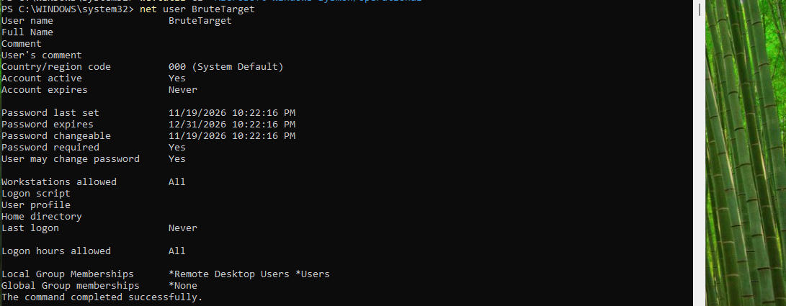
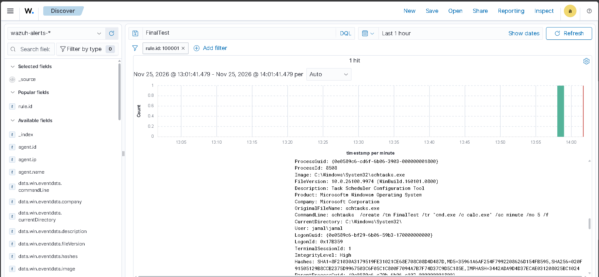

# 🛡️ Project 4: RDP Brute Force & Scheduled Task Detection Lab

> **Project Type:** Defensive SOC Lab — Windows Telemetry Collection, Wazuh Rule Tuning, and Manual Incident Investigation
> **Status:** ✅ **Live Detection Verified** — Custom Rule `100001` fired at **Level 12** in `wazuh-alerts-*` on `2026-11-25`
> **Environment:** Isolated Virtual Lab
> **Author:** Jamal
> **Role Focus:** SOC Analyst Tier 1 / Detection Engineering

---
## 📋 Table of Contents
- [Project Overview](#-project-overview)
- [Lab Architecture](#-lab-architecture)
- [Attack Scenario](#-attack-scenario)
- [Scenario 1: RDP Brute-Force](#-scenario-1-rdp-brute-force-and-successful-authentication)
- [Scenario 2: Scheduled Task Creation](#️-scenario-2-scheduled-task-creation)
- [Threat Hunting and Evidence Analysis](#-threat-hunting-and-evidence-analysis)
- [Custom Wazuh Rule and Detection Tuning](#-custom-wazuh-rule-and-detection-tuning)
- [Rule Iteration History: Five Versions, One Truth](#-rule-iteration-history-five-versions-one-truth)
- [Live Detection Proof](#-live-detection-proof)
- [Archives vs. Alerts: Understanding the Detection Gap](#️-archives-vs-alerts-understanding-the-detection-gap)
- [Detection Engineering Lessons](#-detection-engineering-lessons)
- [MITRE ATT&CK Mapping](#-mitre-attck-mapping)
- [Limitations and Validation Gaps](#-limitations-and-validation-gaps)
- [Next Steps](#-next-steps)
- [References](#-references)
---

## 🔍 Project Overview

This project investigates a simulated RDP-based intrusion scenario in an isolated virtual environment using **Wazuh**, **Windows Security Event Logs**, and **Sysmon**.

The lab covers two related activities:

1. Simulating repeated RDP authentication failures followed by a successful login.
2. Creating a scheduled task inside the remote Windows session to simulate a persistence-related behavior.

The main focus is not simply generating alerts. It is understanding how different telemetry sources provide visibility into authentication and process execution, how Wazuh evaluates collected events, and how custom rules can be used to tune detection behavior.

A second, equally important outcome of this project is the **honest engineering trail**: the custom detection rule did not work on the first attempt. It took **five iterations** and a live debugging session to produce a verified alert. That failure-and-recovery process is documented here in full, because a rule that "looks correct" is not the same as a rule that "actually fires."

### Project Objectives

- Collect Windows Security authentication events through the Wazuh Agent.
- Collect Sysmon process-creation telemetry.
- Investigate failed and successful RDP authentication.
- Examine scheduled task creation activity.
- Search both Wazuh alert data and archived event data.
- Create a conditional custom rule for scheduled-task process execution.
- Validate custom rule syntax **and** validate live behavior.
- Document, with scientific honesty, what was demonstrated and what required operational testing.

> **Scope and evidence note:** This is a controlled educational lab. The project documents the observed results and the current validation status. It does not claim production readiness, complete attack-chain detection, or successful automated incident response.

---

## 🏗️ Lab Architecture

The environment contains three virtual machines.

```text
┌────────────────────────┐
│      Kali Linux        │
│      Attacker VM       │
│      192.168.1.13      │
└───────────┬────────────┘
            │
            │ RDP / TCP 3389
            ▼
┌────────────────────────┐
│      Windows 11        │
│      Victim VM         │
│      192.168.1.18      │
│                        │
│      Wazuh Agent       │
│      Sysmon            │
└───────────┬────────────┘
            │
            │ Windows Security Logs
            │ Sysmon Operational Logs
            ▼
┌────────────────────────┐
│     Ubuntu Server      │
│     Wazuh Manager      │
│     Wazuh Indexer      │
│     Wazuh Dashboard    │
│     192.168.1.14       │
└────────────────────────┘
```

> **IP-address history note (scientific honesty):** The lab ran on a Bridged network and the addresses changed between sessions due to DHCP behavior and an IP conflict discovered during debugging (the victim VM and the host laptop were temporarily assigned the same address). The architecture diagram above reflects the **final verified state** used for the live detection proof. Earlier evidence screenshots (Scenarios 1 and 2) retain the original addresses (`192.168.1.12` for the victim, `192.168.1.10`/`192.168.1.13` for the manager across sessions). Historical evidence is **not** retroactively edited; this note exists so a reader can reconcile old screenshots with the current topology.

### Components

| Component | Role | Purpose |
|---|---|---|
| Kali Linux | Attacker VM | Generates controlled RDP authentication attempts. |
| Windows 11 | Victim VM | Receives RDP connections and generates endpoint telemetry. |
| Wazuh Agent | Endpoint Collector | Forwards configured Windows event sources to Wazuh. |
| Sysmon | Endpoint Telemetry | Records process creation and related process metadata. |
| Ubuntu Server | Wazuh Manager | Receives, decodes, and evaluates collected events. |
| Wazuh Dashboard | Investigation Interface | Supports searching and reviewing security telemetry. |

### Relevant Lab Details

| Item | Value |
|---|---|
| Attacker IP | `192.168.1.13` |
| Victim IP | `192.168.1.18` (final verified state) |
| Wazuh Manager IP | `192.168.1.14` (final verified state) |
| Target Account | `BruteTarget` |
| Scheduled Task Name (original scenario) | `WinUpdater` |
| Validation Task Names (debug iterations) | `WinUpdater3`, `WinUpdater4`, `WinUpdater5`, `WinUpdater6`, `FinalTest` |
| Remote Service | RDP — TCP 3389 |
| Wazuh Version | `4.14.10` |

> **Why multiple task names?** During live debugging, a *new* task name was used for each test so that each event could be uniquely identified in the archives and alerts indices. The original scenario used `WinUpdater`; the verified alert was produced by `FinalTest`. This is a deliberate investigation technique (unique markers per trial), not a change to the attack logic.

---

## ⚔️ Attack Scenario

The lab simulates two activities from the same controlled test environment.

### Scenario 1 — RDP Brute Force and Successful Authentication

The attacker used NetExec to perform RDP authentication attempts against the Windows endpoint.

Command used:

```bash
netexec rdp 192.168.1.12 -u BruteTarget -p pw.txt
```

The test password list contained five incorrect passwords followed by one correct password.

The observed activity included:

- Multiple failed authentication attempts.
- A successful authentication using the test account.
- Windows Security events associated with the authentication attempts.

**Evidence:**




---

## 🔐 Scenario 1: RDP Brute-Force and Successful Authentication

### Failed Authentication — Event ID 4625

Windows Security Event ID `4625` records a failed logon attempt.

The collected evidence showed multiple failed authentication events associated with the test account.

Relevant fields for investigation include:

- `TargetUserName`
- `IpAddress`
- `LogonType`
- `SubStatus`
- `TimeCreated`

The observed SubStatus was:

```text
0xC000006A
```

This status is associated with an incorrect password for an existing account.

The observed Logon Type was `10`, corresponding to RemoteInteractive logon activity.

### Successful Authentication — Event ID 4624

Windows Security Event ID `4624` records a successful logon.

The investigation identified a successful logon with:

```text
Logon Type: 10
```

Logon Type 10 is associated with RemoteInteractive sessions, including Remote Desktop connections.

The successful event was reviewed alongside the preceding failed authentication events and the source address.

**Evidence:**


### Investigation Interpretation

The sequence of failed authentication attempts followed by a successful RDP login is consistent with the simulated password-guessing scenario.

The events provide authentication evidence, but the interpretation depends on their context, including the account, source address, timestamps, and logon type.

---

## 🗓️ Scenario 2: Scheduled Task Creation

After establishing the RDP session, the test account was used to create a scheduled task.

Command executed inside the Windows session:

```cmd
schtasks /create /tn WinUpdater /tr "cmd.exe /c calc.exe" /sc minute /mo 5 /f
```

The task was named:

```text
WinUpdater
```

The configured action was:

```text
cmd.exe /c calc.exe
```

The task was created to simulate a scheduled-task persistence mechanism and generate process-execution telemetry.

### MITRE ATT&CK Context

The behavior is associated with:

`T1053.005 — Scheduled Task/Job: Scheduled Task`

This mapping describes the simulated behavior. It does not, by itself, establish that the activity represents a real-world compromise.

### Local Windows Evidence

The repository includes local Windows evidence associated with scheduled task creation:


**Event Channel Note:**

Windows Security Event ID `4698` is the event associated with a scheduled task being created. It belongs to the Windows Security channel and is provided by the `Microsoft-Windows-Security-Auditing` provider.

It must not be confused with events from:

`Microsoft-Windows-TaskScheduler/Operational`

The Task Scheduler Operational channel contains separate task lifecycle events.

The local evidence image should be interpreted according to the actual channel and event details displayed in the original Windows record. The presence of a local Windows event does not establish that the same event was forwarded to Wazuh.

### Sysmon Process-Creation Evidence

Sysmon Event ID `1` records process creation.

The collected telemetry was used to identify the execution of:

```text
schtasks.exe
```

Relevant Sysmon fields include:

- `Image`
- `CommandLine`
- `ParentImage`
- `ParentCommandLine`
- `ProcessGuid`
- `ParentProcessGuid`
- `UtcTime`

This provides process-execution context for investigating the scheduled task creation activity.

The process event supports investigation of the command execution. It should not be treated as independent proof of every subsequent action performed by the scheduled task.

### Side-Effect Observation (Persistence Behavior)

Because the task was scheduled to repeat every 5 minutes, subsequent Sysmon **Event ID 7 (Image loaded)** records appeared showing `calc.exe` loading `urlmon.dll` with a valid Microsoft signature. This is a *benign side effect* of the simulated payload running repeatedly — but it is exactly the kind of recurring, low-noise activity a real persistence mechanism produces. It is documented here as an observation, not as a detection target.

---

## 🔎 Threat Hunting and Evidence Analysis

The investigation used both alert-oriented searches and archived event searches.

### 1. Authentication Activity Search

A broad search was performed for failed authentication events associated with the test account.

Example query:

```text
data.win.system.eventID:4625 AND data.win.eventdata.targetUserName:BruteTarget
```

The purpose was to isolate the failed authentication activity.

### 2. Successful Authentication Pivot

The investigation then pivoted to Event ID `4624` for the same account.

The successful RDP event was reviewed for:

- Account identity.
- Source IP address.
- Logon Type.
- Timestamp.

The observed successful logon was associated with the attacker address:

```text
192.168.1.13
```

### 3. Pivot to Archived Events

The investigation searched for the scheduled task name:

```text
WinUpdater
```

within the Wazuh Archives data view:

```text
wazuh-archives*
```

The search identified Sysmon Event ID `1` telemetry associated with `schtasks.exe`, shown in the repository evidence at Level 4.

**Evidence:**


### 4. Review of Security Events

A corresponding search in the Security Events view did not return a matching result for the searched activity.

This observation motivated further investigation into the difference between the archived event and the alert view — and ultimately into the custom rule itself (see [Rule Iteration History](#-rule-iteration-history-five-versions-one-truth)).

**Important:** A zero-result search in a particular dashboard view does not, by itself, prove that no alert was generated anywhere in Wazuh. The underlying alert data, query filters, index selection, and time range must also be checked. In this lab, the empty result had **two** distinct causes, both documented below: (a) the custom rule was not firing, and (b) the archives index in Wazuh 4.14 does not store `rule.id` at all, so searching archives by rule ID is structurally impossible.

---

## 🧪 Custom Wazuh Rule and Detection Tuning

The project explored conditional elevation of a specific Sysmon process-creation event.

### Detection Gap Under Investigation

The scheduled task creation command was visible through Sysmon process-creation telemetry.

The observed event was associated with the general Sysmon Event ID `1` rule at Level `4`.

The objective was to distinguish this specific process execution from ordinary process-creation activity and apply a more specific rule.

### Original Custom Rule 100001 (Attempt 1 — Did Not Fire)

The first child rule was written as follows:

```xml
<rule id="100001" level="10">
  <if_sid>81000</if_sid>
  <field name="data.win.eventdata.image">schtasks.exe</field>
  <field name="data.win.eventdata.ruleName">T1053.005</field>
  <description>Scheduled Task Persistence Detected (T1053.005) - Elevated from Level 4</description>
</rule>
```

This rule passed syntax validation but **never produced a live alert**. The reasons are dissected in the next section.

### Final Custom Rule 100001 (Attempt 5 — Verified Live)

The rule that actually fired is:

```xml
<rule id="100001" level="12">
  <if_sid>61603</if_sid>
  <field name="win.eventdata.image" type="pcre2">(?i)\\schtasks\.exe$</field>
  <field name="win.eventdata.commandLine" type="pcre2">(?i)/create</field>
  <description>Scheduled Task creation via schtasks.exe (MITRE T1053.005)</description>
  <mitre>
    <id>T1053.005</id>
  </mitre>
</rule>
```

### Rule Logic (Final Version)

| Condition | Purpose |
|---|---|
| `<if_sid>61603</if_sid>` | Anchors the rule to the **real** parent Sysmon Event ID 1 rule. Without a correct parent anchor, a child rule is never evaluated. |
| `win.eventdata.image` (no `data.` prefix) | Matches the decoder field name as it exists **inside the rule engine**. The `data.` prefix is added only at indexing time for the dashboard. |
| `type="pcre2"` with `(?i)\\schtasks\.exe$` | Case-insensitive regex anchored to the end of the path, reducing false positives from partial matches. |
| `win.eventdata.commandLine` contains `/create` | Requires the task-creation flag, distinguishing creation from enumeration/deletion. |
| `level="12"` | Deliberately set **higher** than the parent rule so the alert stands out in the dashboard and is unambiguous in the proof. |
| `<mitre><id>T1053.005</id></mitre>` | Maps the alert to the ATT&CK technique; Wazuh auto-populates the tactic from the MITRE database. |

### Syntax Validation

The Wazuh rule configuration was checked using:

```bash
sudo /var/ossec/bin/wazuh-analysisd -t
```

The reported result was:

```text
No syntax errors reported.
```

This confirms that the rule configuration passed the syntax validation performed by the Wazuh analysis engine. **Syntax validation alone, however, did not predict the live behavior** — see the iteration history below.

---

## 🔬 Rule Iteration History: Five Versions, One Truth

The custom rule failed four times before succeeding. Each failure taught a concrete detection-engineering lesson. This table is the most valuable part of the project, because it documents *why* a rule that "looks right" can still be silent.

| Version | Parent Anchor | Field Names | Extra Conditions | Live Result | Root Cause |
|---|---|---|---|---|---|
| **v1** (original) | `if_sid 81000` | `data.win.eventdata.*` | `ruleName` = T1053.005 | ❌ Silent | Two compounding errors: (1) parent `81000` is not the Sysmon Event 1 rule, so the child was never reached; (2) the `data.` prefix is invalid inside rule XML. |
| **v2** | `if_sid 61603` | `win.eventdata.*` | `ruleName` = T1053.005 | ⚠️ Not live-tested | Corrected the anchor and prefix, but was abandoned before a live trigger because debugging time was spent on infrastructure (network/IP conflicts) instead of the rule. |
| **v3** | *(none)* | `win.eventdata.*` + `win.system.eventID` + `win.system.providerName` | — | ❌ Silent | A rule with **no parent anchor** does not enter the EventChannel evaluation tree in this build. Empirically proven by `wazuh-logtest` and live testing. |
| **v4** | `decoded_as windows_eventchannel` | same as v3 | — | ❌ Silent | Same structural problem as v3: the anchor type did not place the rule on the path that Sysmon EventChannel events traverse. |
| **v5** (final) | `if_sid 61603` | `win.eventdata.image` + `win.eventdata.commandLine` | `/create` flag | ✅ **Fired Level 12** | Correct parent anchor + decoder-native field names + a behavioral condition (`/create`) instead of relying on the Sysmon `ruleName` string. |

### What `wazuh-logtest` Proved

Running the raw `full_log` through `/var/ossec/bin/wazuh-logtest` showed, in **Phase 2 (Completed decoding)**, that the decoder exposes fields as:

```text
win.eventdata.image
win.eventdata.commandLine
win.eventdata.ruleName
win.system.eventID
win.system.providerName
```

— i.e. **without** the `data.` prefix. This is the definitive evidence that the `data.` prefix seen in the dashboard is an *indexing-time* artifact, not a rule-engine field name. Mixing the two namespaces is the single most common cause of a "correct-looking" rule that never fires.

### Honest Limitation of This Analysis

The exact internal reason why v3 and v4 (anchor-less / `decoded_as`-anchored rules) were not evaluated for EventChannel Sysmon events was **not** proven from first principles. It is documented here as a reproducible empirical observation: with `if_sid 61603` the rule fires; without a valid parent anchor it does not. That is sufficient for the lab's purpose, and it is stated as an observation rather than a claimed mechanism.

---

## ✅ Live Detection Proof

The final rule was validated against a live event, not only against `wazuh-logtest`.

**Trigger command (Windows, elevated CMD):**

```cmd
schtasks /create /tn FinalTest /tr "cmd.exe /c calc.exe" /sc minute /mo 5 /f
```

**Verification path:** Wazuh Dashboard → Discover → index `wazuh-alerts-*` → filter `rule.id: 100001` → query `FinalTest` → time range `Last 1 hour`.

**Result:** `1 hit`, with the following rule metadata in the alert document:

```text
_index                  : wazuh-alerts-4.x-2026.11.25
agent.id                : 003
agent.name              : windows
agent.ip                : 192.168.1.18
rule.id                 : 100001
rule.level              : 12
rule.firedtimes         : 1
rule.groups             : local, syslog, sshd
rule.mitre.id           : T1053.005
rule.mitre.tactic       : Execution, Persistence, Privilege Escalation
rule.mitre.technique    : Scheduled Task
decoder.name            : windows_eventchannel
location                : EventChannel
data.win.system.eventID : 1
data.win.system.providerName : Microsoft-Windows-Sysmon
data.win.eventdata.image     : C:\Windows\System32\schtasks.exe
data.win.eventdata.commandLine : schtasks /create /tn FinalTest /tr "cmd.exe /c calc.exe" /sc minute /mo 5 /f
data.win.eventdata.parentImage : C:\Windows\System32\cmd.exe
timestamp               : Nov 25, 2026 @ 13:58:41.182
```

**Evidence:**



> The screenshot shows the `rule.id: 100001` filter chip active, exactly `1 hit`, the histogram spike at the trigger time, and the expanded message body containing `schtasks.exe` + `FinalTest`. The JSON view confirms `rule.level: 12`.

### What Has and Has Not Been Proven

**Demonstrated (live):**

- The custom rule `100001` fired on a real Sysmon Event ID 1 process-creation event.
- The resulting alert carried `rule.id = 100001` and `rule.level = 12`.
- The alert was correctly mapped to MITRE `T1053.005` with tactics `Execution, Persistence, Privilege Escalation`.
- The alert was visible in `wazuh-alerts-*` (the correct index), and **not** findable by rule ID in `wazuh-archives-*` (because that index does not store `rule.id` in Wazuh 4.14).

**Not yet demonstrated by the currently documented evidence:**

- That *benign* `schtasks.exe` executions (e.g. a legitimate administrative task creation, or Windows' own maintenance tasks) are correctly distinguished from the simulated one. The `/create` flag is present in both benign and malicious creation, so systematic false-positive testing is still required.
- That the rule survives a Wazuh upgrade (it lives in `local_rules.xml`, which is upgrade-safe, but this was not re-tested after an upgrade).
- That the rule scales to high-volume environments without tuning (no load test was performed).

Therefore, this project documents the rule as **created, syntax-validated, and live-verified for the positive case**, while explicitly leaving the **false-positive / benign-activity case** as an open validation gap.

---

## ⚖️ Archives vs. Alerts: Understanding the Detection Gap

A key investigation lesson from this project is the critical need to distinguish between collected event data and generated security alerts.

| Concept | Wazuh Location / Component | Purpose |
|---|---|---|
| **Archived Events** | `wazuh-archives*` | Stores raw, collected event data from agents when archival is enabled. In Wazuh 4.14 it does **not** populate `rule.id`. |
| **Rule Evaluation** | Wazuh Analysis Engine (`wazuh-analysisd`) | Evaluates decoded events against the loaded ruleset to find matches. |
| **Generated Alerts** | `wazuh-alerts*` / `/var/ossec/logs/alerts/alerts.json` | Contains *only* the events that triggered an alert based on matching rules. Carries `rule.id` and `rule.level`. |
| **Alert Severity** | `rule.level` | Indicates the risk level (0–16) assigned to the matching rule. |

### 💡 Practical Takeaway from this Lab

During the investigation of the persistence mechanism (`schtasks.exe`), we observed a classic **Detection Gap (Blind Spot)**, and then closed it:

1. The malicious process creation (Sysmon Event ID 1) was successfully collected and is visible in `wazuh-archives*`.
2. Initially, **no alert was generated** in `wazuh-alerts*` for the targeted pattern.
3. **Root Cause (two layers):**
   - *Rule layer:* the custom rule was mis-anchored and used dashboard field names instead of decoder field names, so it never fired (see [Rule Iteration History](#-rule-iteration-history-five-versions-one-truth)).
   - *Search layer:* searching `wazuh-archives*` by `rule.id` is structurally impossible in Wazuh 4.14, because that index does not store `rule.id`. This made the "no alert" observation easy to misread.
4. **Solution:** correct the rule (valid parent anchor + decoder-native fields), verify with `wazuh-logtest`, then confirm live behavior in `wazuh-alerts*`. This highlights the necessity of proactive **Threat Hunting** in archives to discover blind spots, followed by engineering **Custom Wazuh Rules** to close the gap — and verifying the closure in the *alerts* index, not the archives index.

### Important Wazuh Level Clarification

Wazuh rule levels range from `0` to `16`.

In the default Wazuh configuration, the alert threshold is generally Level `3` (`log_alert_level`).

Therefore, a Level `4` event can generate an alert. Level 4 does **not** inherently mean that no alert exists.

If an event appears in Archives but is not visible in a particular Security Events view, possible explanations include:

- The event did not match an alert-generating rule.
- The event was processed by a different rule than expected.
- The dashboard query or time filter excluded the alert.
- The relevant alert index was not included in the search.
- The search was performed against `wazuh-archives*` by `rule.id`, which that index does not contain.
- Alert-generation settings differ from the default configuration.

The correct investigation method is to inspect the actual alert record in `wazuh-alerts*` and its rule metadata, rather than infer alert absence from the rule level or from a single dashboard search.

### Key Takeaway

**Event collection, rule matching, alert generation, and dashboard visibility are separate things that must be validated independently.** An archived event is useful investigation evidence, but its presence alone does not establish whether a corresponding alert was generated — and the archives index is the wrong place to look for `rule.id`.

---

## 🧠 Detection Engineering Lessons

These are the transferable principles extracted from this lab, suitable for interview discussion and for reuse in production rule development.

1. **`if_sid` is not decoration — it is the entry door to the evaluation tree.** A child rule is only evaluated if its parent rule fires first. A rule with no valid parent anchor (or an anchor pointing to a rule that does not match the event's decoder/category) is permanently silent, regardless of how correct its `<field>` conditions look.
2. **Field names have dual personalities.** Inside rule XML, use the *decoder* name: `win.eventdata.image`. Inside the dashboard/index JSON, the same field appears as `data.win.eventdata.image` because the `data.` prefix is added at indexing time. Mixing the two namespaces produces a rule that passes syntax validation but never matches.
3. **Validate behavior, not just syntax.** `wazuh-analysisd -t` proves the XML is well-formed. `wazuh-logtest` proves the rule *would* match a given raw log (Phase 3 shows the winning rule ID and level). Only a live trigger in `wazuh-alerts*` proves the rule fires in the real pipeline. All three are different tests.
4. **Prefer behavioral conditions over vendor-string conditions.** Matching on the Sysmon `ruleName` string (e.g. `T1053.005`) couples the detection to a specific Sysmon configuration that may not be deployed everywhere. Matching on `image` + `commandLine` (`/create`) detects the *behavior* and is more portable.
5. **Choose the right index for the right question.** `wazuh-archives*` answers "did we collect this event?" `wazuh-alerts*` answers "did a rule fire on it?" Searching archives for `rule.id` is a category error in Wazuh 4.14.
6. **Use unique markers per test.** Renaming the scheduled task on each iteration (`WinUpdater3` … `FinalTest`) lets you isolate exactly which trial produced which alert, which is essential when debugging a rule that sometimes fires and sometimes does not.
7. **Document failures honestly.** A README that only shows the working rule hides the real engineering work. The five-iteration table is more valuable to a reviewer than a single "correct" snippet, because it demonstrates debugging methodology rather than copy-paste.

---

## 🎯 MITRE ATT&CK Mapping

The following techniques describe the behaviors simulated in this lab.

| Observed Behavior | Telemetry | MITRE Tactic | MITRE Technique |
|---|---|---|---|
| Password Guessing | Windows Security Event ID `4625` | Credential Access | `T1110.001` — Password Guessing |
| RDP Authentication | Windows Security Event IDs `4624` and `4625` | Lateral Movement | `T1021.001` — Remote Desktop Protocol |
| Scheduled Task Creation | Sysmon Event ID `1` (`schtasks.exe` + `/create`) | Execution, Persistence, Privilege Escalation | `T1053.005` — Scheduled Task |

**Mapping qualification:** Event IDs provide supporting telemetry. ATT&CK mapping should be based on the behavior demonstrated by the evidence, not on an event ID alone. The `T1053.005` mapping in the verified alert is auto-populated by Wazuh from the MITRE database once `<mitre><id>T1053.005</id></mitre>` is declared in the rule; the tactics column above reflects what Wazuh reported in the live alert (`Execution, Persistence, Privilege Escalation`).

---

## 🚧 Limitations and Validation Gaps

The project was performed in an isolated lab and has the following limitations:

| Area | Current Limitation |
|---|---|
| Live Custom Rule Validation | ✅ **Closed.** Rule `100001` fired at Level 12 on a live event; evidence in `wazuh-alerts-*`. |
| False-Positive / Benign Testing | ❌ **Open.** Benign `schtasks.exe /create` (legitimate admin tasks, Windows maintenance) has not been systematically tested against the rule. The `/create` flag is shared by benign and malicious creation, so FP rate is unknown. |
| Alert Visibility Reconciliation | ✅ **Closed.** The archives-vs-alerts confusion is resolved and documented (archives does not store `rule.id` in 4.14). |
| Automated Correlation | ❌ **Open.** The investigation was performed manually. No automated rule chain linking the authentication (4624/4625) and the scheduled-task (Sysmon 1) events was implemented. |
| Active Response | ❌ **Open.** Wazuh Active Response was not configured to block the attacker IP. |
| Distributed Attacker Testing | ❌ **Open.** The scenario used one attacker IP and did not test rotating or distributed sources. |
| Additional Telemetry | ❌ **Open.** DNS, firewall, proxy, and other network telemetry were not integrated into this scenario. |
| Persistence Verification | ❌ **Open.** The project simulated scheduled task creation; it does not establish long-term persistence effectiveness or survival across all system states (e.g. reboot, profile load). |
| Upgrade Durability | ❌ **Open.** The rule lives in `local_rules.xml` (upgrade-safe by design), but survival across an actual Wazuh upgrade was not re-tested. |
| Load / Scale | ❌ **Open.** No high-volume test was performed; tuning for noisy environments is unverified. |

These limitations define the scope of the current lab and provide clear targets for future testing. The single most important open gap is **false-positive testing**, because a detection that fires on every legitimate `schtasks /create` is worse than no detection at all.

---

## 🚀 Next Steps

The following improvements are planned, ordered by priority:

### 1. Test Benign Activity (highest priority — closes the FP gap)

- Create a legitimate scheduled task with `schtasks /create` using a non-malicious action (e.g. a backup script).
- Confirm whether rule `100001` fires on it.
- If it does, tighten the rule (e.g. require a suspicious parent process, or a payload pattern such as `cmd.exe /c` + a non-standard binary) and re-test.
- Document the benign-vs-malicious comparison with evidence.

### 2. Explore Automated Correlation

Investigate whether Wazuh correlation mechanisms can combine related authentication and endpoint events into a single higher-fidelity alert.

Potential components include:

- `<if_matched_sid>`
- `frequency`
- `timeframe`
- Same-field correlation conditions (e.g. `same_srcip`, `same_user`).

Any automated correlation should be tested with controlled events before being described as implemented.

### 3. Evaluate Active Response

Test Wazuh Active Response in the isolated lab and verify the actual response action (e.g. blocking the attacker IP at the firewall) before documenting it as successful containment.

### 4. Expand Telemetry

Potential future integrations include:

- Windows Defender logs.
- PowerShell Script Block Logging.
- DNS telemetry (Sysmon Event ID 22).
- Firewall events.
- Network monitoring sources.

### 5. Reconcile and Stabilize the Lab Network

- Move the lab to a **NAT** network (or apply DHCP reservations on the router) to eliminate the IP-conflict class of failures observed during this session, so future debugging time is spent on detection logic rather than connectivity.

### 6. Verify Upgrade Durability

- After a Wazuh version upgrade, re-run `wazuh-logtest` and a live trigger to confirm `local_rules.xml` custom rules survive intact.

---

## 📚 References

- [Wazuh Documentation — Data Analysis / Ruleset](https://documentation.wazuh.com/current/user-manual/ruleset/index.html)
- [Wazuh Documentation — Custom Rules](https://documentation.wazuh.com/current/user-manual/ruleset/rules/custom.html)
- [Wazuh Documentation — Rules XML Syntax](https://documentation.wazuh.com/current/user-manual/ruleset/ruleset-xml-syntax/rules.html)
- [MITRE ATT&CK](https://attack.mitre.org/)
- [Microsoft — Windows Security Auditing](https://learn.microsoft.com/en-us/windows/security/threat-protection/auditing/)
- [Microsoft Sysinternals — Sysmon](https://learn.microsoft.com/en-us/sysinternals/downloads/sysmon)
- [NetExec Documentation](https://www.netexec.wiki/)

---

## 📝 Final Note

This project demonstrates practical SOC investigation activities in an isolated environment:

- Simulating RDP authentication attempts.
- Reviewing Windows Security authentication events.
- Collecting Sysmon process-creation telemetry.
- Investigating scheduled task creation.
- Searching archived events and alert data.
- Creating, debugging, and **live-verifying** a conditional Wazuh rule across five iterations.

The project also highlights an important detection-engineering principle: **a rule that passes syntax validation is not automatically a rule that has been proven to detect the intended activity.** The verified alert (Level 12, rule `100001`, in `wazuh-alerts-*`) closes the positive-case gap; the false-positive case remains explicitly open and is the top priority for the next iteration.

The goal is to build detections that are testable, explainable, and supported by observable evidence — and to document the failures as rigorously as the successes.

**Built with discipline. Documented with integrity.**
