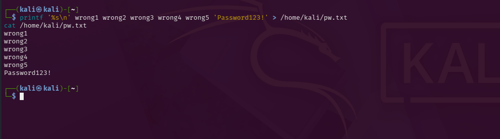
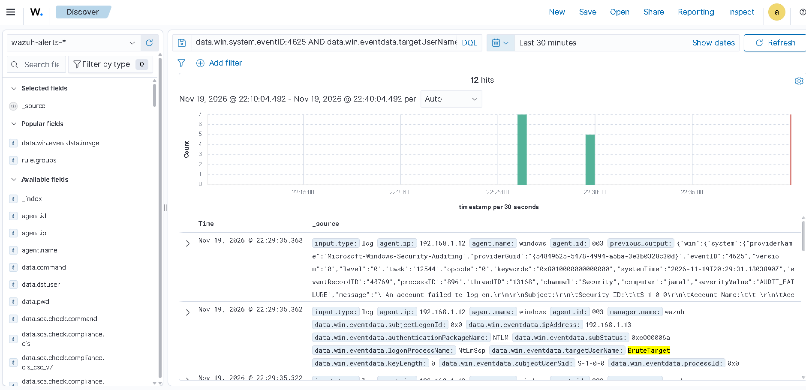
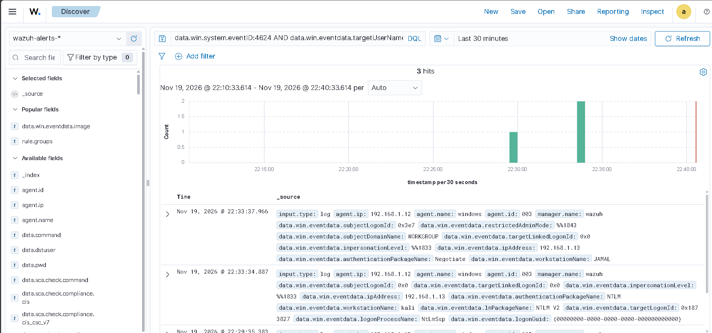
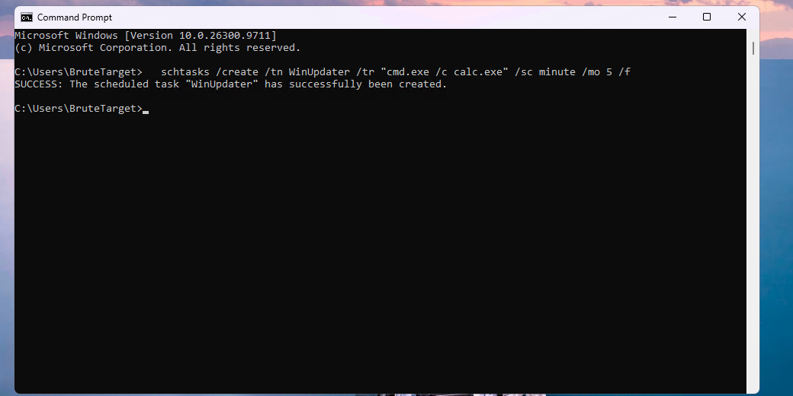
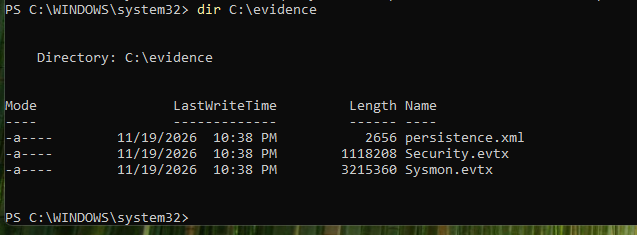
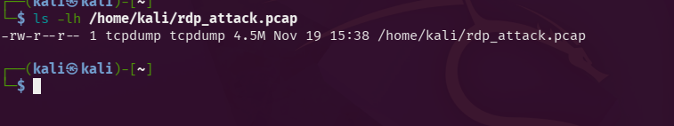

# 🛡️ Project 4: RDP Brute Force & Scheduled Task Detection Lab

> **Project Type:** Defensive SOC Lab — Windows Telemetry Collection, Wazuh Rule Tuning, and Manual Incident Investigation  
> **Status:** Attack Scenario Executed — Custom Rule Syntax Validated — Live Level 10 Detection Pending Verification  
> **Environment:** Isolated Virtual Lab  
> **Author:** Jamal  
> **Role Focus:** SOC Analyst Tier 1 / Detection Engineering

---
## 📋 Table of Contents
- [Project Overview](#-project-overview)
- [Lab Architecture](#-lab-architecture)
- [Attack Scenario](#-attack-scenario)
- [Scenario 1: RDP Brute-Force](#-scenario-1-rdp-brute-force-and-successful-authentication)
- [Scenario 2: Scheduled Task Creation](#-scenario-2-scheduled-task-creation)
- [Threat Hunting and Evidence Analysis](#-threat-hunting-and-evidence-analysis)
- [Custom Wazuh Rule and Detection Tuning](#-custom-wazuh-rule-and-detection-tuning)
- [Archives vs. Alerts](#-archives-vs-alerts-understanding-the-detection-gap)
- [MITRE ATT&CK Mapping](#-mitre-attck-mapping)
- [Limitations and Validation Gaps](#-limitations-and-validation-gaps)
- [Next Steps](#-next-steps)
- [References](#-references)
---

## 🔍 Project Overview

This project investigates a simulated RDP-based intrusion scenario in an isolated virtual environment using **Wazuh**, **Windows Security Event Logs**, and **Sysmon**.

The lab covers two related activities:

1. Simulating repeated RDP authentication failures followed by a successful login.
2. Creating a scheduled task inside the remote Windows session to simulate a persistence-related behavior.

The main focus is not simply generating alerts. It is understanding how different telemetry sources provide visibility into authentication and process execution, how Wazuh evaluates collected events, and how custom rules can be used to tune detection behavior.

### Project Objectives

- Collect Windows Security authentication events through the Wazuh Agent.
- Collect Sysmon process-creation telemetry.
- Investigate failed and successful RDP authentication.
- Examine scheduled task creation activity.
- Search both Wazuh alert data and archived event data.
- Create a conditional custom rule for scheduled-task process execution.
- Validate custom rule syntax.
- Identify what has been demonstrated and what still requires operational testing.

> **Scope and evidence note:** This is a controlled educational lab. The project documents the observed results and the current validation status. It does not claim production readiness, complete attack-chain detection, or successful automated incident response.

---

## 🏗️ Lab Architecture

The environment contains three virtual machines.

```text
┌────────────────────────┐
│      Kali Linux        │
│      Attacker VM       │
│      192.168.1.13      │
└───────────┬────────────┘
            │
            │ RDP / TCP 3389
            ▼
┌────────────────────────┐
│      Windows 11        │
│      Victim VM         │
│      192.168.1.12      │
│                        │
│      Wazuh Agent       │
│      Sysmon            │
└───────────┬────────────┘
            │
            │ Windows Security Logs
            │ Sysmon Operational Logs
            ▼
┌────────────────────────┐
│     Ubuntu Server      │
│     Wazuh Manager      │
│     Wazuh Indexer      │
│     Wazuh Dashboard    │
└────────────────────────┘
```

### Components

| Component | Role | Purpose |
|---|---|---|
| Kali Linux | Attacker VM | Generates controlled RDP authentication attempts. |
| Windows 11 | Victim VM | Receives RDP connections and generates endpoint telemetry. |
| Wazuh Agent | Endpoint Collector | Forwards configured Windows event sources to Wazuh. |
| Sysmon | Endpoint Telemetry | Records process creation and related process metadata. |
| Ubuntu Server | Wazuh Manager | Receives, decodes, and evaluates collected events. |
| Wazuh Dashboard | Investigation Interface | Supports searching and reviewing security telemetry. |

### Relevant Lab Details

| Item | Value |
|---|---|
| Attacker IP | `192.168.1.13` |
| Victim IP | `192.168.1.12` |
| Target Account | `BruteTarget` |
| Scheduled Task Name | `WinUpdater` |
| Remote Service | RDP — TCP 3389 |

---

## ⚔️ Attack Scenario

The lab simulates two activities from the same controlled test environment.

### Scenario 1 — RDP Brute Force and Successful Authentication

The attacker used NetExec to perform RDP authentication attempts against the Windows endpoint.

Command used:

```bash
netexec rdp 192.168.1.12 -u BruteTarget -p pw.txt
```

The test password list contained five incorrect passwords followed by one correct password.

The observed activity included:

- Multiple failed authentication attempts.
- A successful authentication using the test account.
- Windows Security events associated with the authentication attempts.

**Evidence:**





---

## 🔐 Scenario 1: RDP Brute-Force and Successful Authentication

### Failed Authentication — Event ID 4625

Windows Security Event ID `4625` records a failed logon attempt.

The collected evidence showed multiple failed authentication events associated with the test account.

Relevant fields for investigation include:

- `TargetUserName`
- `IpAddress`
- `LogonType`
- `SubStatus`
- `TimeCreated`

The observed SubStatus was:

```text
0xC000006A
```

This status is associated with an incorrect password for an existing account.

The observed Logon Type was `10`, corresponding to RemoteInteractive logon activity.

### Successful Authentication — Event ID 4624

Windows Security Event ID `4624` records a successful logon.

The investigation identified a successful logon with:

```text
Logon Type: 10
```

Logon Type 10 is associated with RemoteInteractive sessions, including Remote Desktop connections.

The successful event was reviewed alongside the preceding failed authentication events and the source address.

**Evidence:**





### Investigation Interpretation

The sequence of failed authentication attempts followed by a successful RDP login is consistent with the simulated password-guessing scenario.

The events provide authentication evidence, but the interpretation depends on their context, including the account, source address, timestamps, and logon type.

---

## 🗓️ Scenario 2: Scheduled Task Creation

After establishing the RDP session, the test account was used to create a scheduled task.

Command executed inside the Windows session:

```cmd
schtasks /create /tn WinUpdater /tr "cmd.exe /c calc.exe" /sc minute /mo 5 /f
```

The task was named:

```text
WinUpdater
```

The configured action was:

```text
cmd.exe /c calc.exe
```

The task was created to simulate a scheduled-task persistence mechanism and generate process-execution telemetry.

### MITRE ATT&CK Context

The behavior is associated with:

`T1053.005 — Scheduled Task/Job: Scheduled Task`

This mapping describes the simulated behavior. It does not, by itself, establish that the activity represents a real-world compromise.

### Local Windows Evidence

The repository includes local Windows evidence associated with scheduled task creation:








**Event Channel Note:**

Windows Security Event ID `4698` is the event associated with a scheduled task being created. It belongs to the Windows Security channel and is provided by the `Microsoft-Windows-Security-Auditing` provider.

It must not be confused with events from:

`Microsoft-Windows-TaskScheduler/Operational`

The Task Scheduler Operational channel contains separate task lifecycle events.

The local evidence image should be interpreted according to the actual channel and event details displayed in the original Windows record. The presence of a local Windows event does not establish that the same event was forwarded to Wazuh.

### Sysmon Process-Creation Evidence

Sysmon Event ID `1` records process creation.

The collected telemetry was used to identify the execution of:

```text
schtasks.exe
```

Relevant Sysmon fields include:

- `Image`
- `CommandLine`
- `ParentImage`
- `ParentCommandLine`
- `ProcessGuid`
- `ParentProcessGuid`
- `UtcTime`

This provides process-execution context for investigating the scheduled task creation activity.

The process event supports investigation of the command execution. It should not be treated as independent proof of every subsequent action performed by the scheduled task.

---

## 🔎 Threat Hunting and Evidence Analysis

The investigation used both alert-oriented searches and archived event searches.

### 1. Authentication Activity Search

A broad search was performed for failed authentication events associated with the test account.

Example query:

```text
data.win.system.eventID:4625 AND data.win.eventdata.targetUserName:BruteTarget
```

The purpose was to isolate the failed authentication activity.

### 2. Successful Authentication Pivot

The investigation then pivoted to Event ID `4624` for the same account.

The successful RDP event was reviewed for:

- Account identity.
- Source IP address.
- Logon Type.
- Timestamp.

The observed successful logon was associated with the attacker address:

```text
192.168.1.13
```

### 3. Pivot to Archived Events

The investigation searched for the scheduled task name:

```text
WinUpdater
```

within the Wazuh Archives data view:

```text
wazuh-archives*
```

The search identified Sysmon Event ID `1` telemetry associated with `schtasks.exe`, shown in the repository evidence at Level 4.

**Evidence:**


### 4. Review of Security Events

A corresponding search in the Security Events view did not return a matching result for the searched activity.

This observation motivated further investigation into the difference between the archived event and the alert view.

**Important:** A zero-result search in a particular dashboard view does not, by itself, prove that no alert was generated anywhere in Wazuh. The underlying alert data, query filters, index selection, and time range must also be checked.

---

## 🧪 Custom Wazuh Rule and Detection Tuning

The project explored conditional elevation of a specific Sysmon process-creation event.

### Detection Gap Under Investigation

The scheduled task creation command was visible through Sysmon process-creation telemetry.

The observed event was associated with the general Sysmon Event ID `1` rule at Level `4`.

The objective was to distinguish this specific process execution from ordinary process-creation activity and apply a more specific rule.

### Custom Rule 100001

The following child rule was created:

```xml
<rule id="100001" level="10">
  <if_sid>81000</if_sid>
  <field name="data.win.eventdata.image">schtasks.exe</field>
  <field name="data.win.eventdata.ruleName">T1053.005</field>
  <description>Scheduled Task Persistence Detected (T1053.005) - Elevated from Level 4</description>
</rule>
```

### Rule Logic

| Condition | Purpose |
|---|---|
| `<if_sid>81000</if_sid>` | Requires the parent Sysmon process-creation rule to match. |
| `data.win.eventdata.image` | Restricts the match to the `schtasks.exe` process image. |
| `data.win.eventdata.ruleName` | Requires the associated MITRE rule name `T1053.005`. |
| `level="10"` | Assigns Level 10 if the child rule matches. |

The rule is intended to elevate the specific scheduled-task-related process event rather than changing the severity of all Sysmon process-creation events.

### Syntax Validation

The Wazuh rule configuration was checked using:

```bash
sudo /var/ossec/bin/wazuh-analysisd -t
```

The reported result was:

```text
No syntax errors reported.
```

This confirms that the rule configuration passed the syntax validation performed by the Wazuh analysis engine.

### What Has and Has Not Been Proven

**Demonstrated:**

- The custom rule was written.
- The rule contains conditions for the parent rule, process image, and MITRE rule name.
- The Wazuh syntax validation command reported no syntax errors.

**Not yet demonstrated by the currently documented evidence:**

- That the live scheduled-task event matched custom rule `100001`.
- That the resulting alert contained `rule.id = 100001`.
- That the resulting alert contained `rule.level = 10`.
- That benign `schtasks.exe` executions were correctly distinguished from suspicious ones.

Therefore, this project documents the rule as **created and syntax-validated**, not as a fully operationally verified detection.

---

## ⚖️ Archives vs. Alerts: Understanding the Detection Gap

A key investigation lesson from this project is the critical need to distinguish between collected event data and generated security alerts. 

| Concept | Wazuh Location / Component | Purpose |
|---|---|---|
| **Archived Events** | `wazuh-archives*` | Stores raw, collected event data from agents when archival is enabled. |
| **Rule Evaluation** | Wazuh Analysis Engine | Evaluates decoded events against the loaded ruleset to find matches. |
| **Generated Alerts** | `wazuh-alerts*` / `alerts.json` | Contains *only* the events that triggered an alert based on matching rules. |
| **Alert Severity** | `rule.level` | Indicates the risk level (0-15) assigned to the matching rule. |

### 💡 Practical Takeaway from this Lab:
During the investigation of the persistence mechanism (`schtasks.exe`), we observed a classic **Detection Gap (Blind Spot)**:
1. The malicious process creation (Sysmon Event ID 1) was successfully collected and is visible in the `wazuh-archives*`.
2. However, **no alert was generated** in `wazuh-alerts*`. 
3. **The Root Cause:** Wazuh operates on rule-matching. While it collected the log, it lacks a specific default rule to detect this exact malicious pattern (`schtasks.exe` executing a hidden `cmd.exe` payload). 
4. **The Solution:** This highlights the necessity of proactive **Threat Hunting** in archives to discover blind spots, followed by engineering **Custom Wazuh Rules** to close the gap and ensure future automated detection.

### Important Wazuh Level 4 Clarification

Wazuh rule levels range from `0` to `16`.

In the default Wazuh configuration, the alert threshold is generally Level `3` (`log_alert_level`).

Therefore, a Level `4` event can generate an alert. Level 4 does **not** inherently mean that no alert exists.

If an event appears in Archives but is not visible in a particular Security Events view, possible explanations include:

- The event did not match an alert-generating rule.
- The event was processed by a different rule than expected.
- The dashboard query or time filter excluded the alert.
- The relevant alert index was not included in the search.
- Alert-generation settings differ from the default configuration.

The correct investigation method is to inspect the actual alert record and its rule metadata rather than infer alert absence from the rule level or a single dashboard search.

### Key Takeaway

**Event collection, rule matching, alert generation, and dashboard visibility are separate things that must be validated independently.**

An archived event is useful investigation evidence, but its presence alone does not establish whether a corresponding alert was generated.

---

## 🎯 MITRE ATT&CK Mapping

The following techniques describe the behaviors simulated in this lab.

| Observed Behavior | Telemetry | MITRE Tactic | MITRE Technique |
|---|---|---|---|
| Password Guessing | Windows Security Event ID `4625` | Credential Access | `T1110.001` — Password Guessing |
| RDP Authentication | Windows Security Event IDs `4624` and `4625` | Lateral Movement | `T1021.001` — Remote Desktop Protocol |
| Scheduled Task Creation | Windows task-related evidence and Sysmon process telemetry | Persistence | `T1053.005` — Scheduled Task |

**Mapping qualification:** Event IDs provide supporting telemetry. ATT&CK mapping should be based on the behavior demonstrated by the evidence, not on an event ID alone.

---

## 🚧 Limitations and Validation Gaps

The project was performed in an isolated lab and has the following limitations:

| Area | Current Limitation |
|---|---|
| Live Custom Rule Validation | Syntax validation was completed, but a matching Level 10 alert from rule `100001` has not yet been documented. |
| Alert Visibility | The Archives and Security Events search results need to be reconciled against the underlying alert records and query settings. |
| False-Positive Testing | Benign scheduled task creation and legitimate administrative process execution have not been tested systematically. |
| Automated Correlation | The investigation was performed manually. No automated rule chain linking the authentication and scheduled-task events was implemented. |
| Active Response | Wazuh Active Response was not configured to block the attacker IP. |
| Distributed Attacker Testing | The scenario used one attacker IP and did not test rotating or distributed sources. |
| Additional Telemetry | DNS, firewall, proxy, and other network telemetry were not integrated into this scenario. |
| Persistence Verification | The project simulated scheduled task creation; it does not establish long-term persistence effectiveness or survival across all system states. |

These limitations define the scope of the current lab and provide clear targets for future testing.

---

## 🚀 Next Steps

The following improvements are planned:

### 1. Verify Custom Rule Matching

- Trigger the scheduled task creation scenario again in the isolated lab when practical.
- Confirm that the parent rule `81000` matches the Sysmon event.
- Inspect the resulting alert record.
- Verify `rule.id = 100001` and `rule.level = 10`.
- Capture the resulting evidence if the rule matches successfully.

### 2. Reconcile Archives and Alerts

- Inspect the same event in the archive data.
- Search the corresponding alert data.
- Confirm the time range, index, and query filters.
- Document why an event is or is not visible in the expected view.

### 3. Test Benign Activity

- Create a legitimate scheduled task.
- Compare its Sysmon process metadata with the simulated test.
- Evaluate whether the custom rule is sufficiently specific.
- Adjust the detection logic only when testing supports the change.

### 4. Explore Automated Correlation

Investigate whether Wazuh correlation mechanisms can combine related authentication and endpoint events.

Potential components include:

- `<if_matched_sid>`
- `frequency`
- `timeframe`
- Same-field correlation conditions.

Any automated correlation should be tested with controlled events before being described as implemented.

### 5. Expand Telemetry

Potential future integrations include:

- Windows Defender logs.
- PowerShell Script Block Logging.
- DNS telemetry.
- Firewall events.
- Network monitoring sources.

### 6. Evaluate Active Response

Test Wazuh Active Response in the isolated lab and verify the actual response action before documenting it as successful containment.

---

## 📚 References

- [Wazuh Documentation — Rules and Decoders](https://documentation.wazuh.com/current/user-manual/ruleset/index.html)
- [Wazuh Documentation — Custom Rules](https://documentation.wazuh.com/current/user-manual/ruleset/rules/custom.html)
- [Wazuh Documentation — Rules Classification](https://documentation.wazuh.com/current/user-manual/ruleset/rules-classification.html)
- [Wazuh Documentation — Rules XML Syntax](https://documentation.wazuh.com/current/user-manual/ruleset/ruleset-xml-syntax/rules.html)
- [MITRE ATT&CK](https://attack.mitre.org/)
- [Microsoft — Windows Security Auditing](https://learn.microsoft.com/en-us/windows/security/threat-protection/auditing/)
- [Microsoft Sysinternals — Sysmon](https://learn.microsoft.com/en-us/sysinternals/downloads/sysmon)
- [NetExec Documentation](https://www.netexec.wiki/)

---

## 📝 Final Note

This project demonstrates practical SOC investigation activities in an isolated environment:

- Simulating RDP authentication attempts.
- Reviewing Windows Security authentication events.
- Collecting Sysmon process-creation telemetry.
- Investigating scheduled task creation.
- Searching archived events and alert data.
- Creating and syntax-validating a conditional Wazuh rule.

The project also highlights an important detection-engineering principle: **a rule that passes syntax validation is not automatically a rule that has been proven to detect the intended activity.**

The next validation step is to confirm the actual matching alert and compare it with the original event evidence.

The goal is to build detections that are testable, explainable, and supported by observable evidence.

**Built with discipline. Documented with integrity.**
