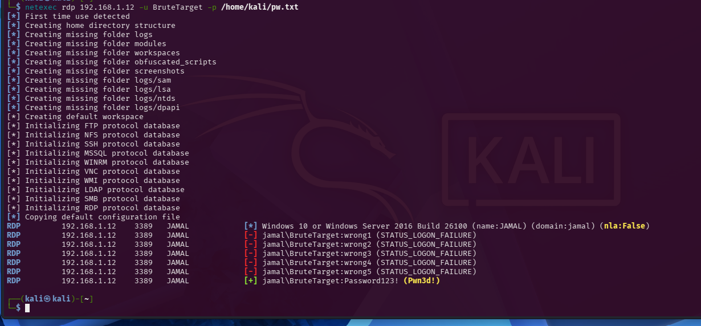

# 🛡️ Project 4: RDP Brute Force & Persistence Detection Lab

**Author:** Jamal  
**Role Target:** SOC Analyst Tier 1 / Detection Engineer  
**Tech Stack:** Wazuh v4.x, Sysmon (Olaf Hartong Modular), Windows 11, Kali Linux, NetExec, MITRE ATT&CK  

## 📖 Executive Summary
This project simulates a complete RDP attack chain (Brute Force → Account Compromise → Persistence) and validates how each stage is detected — and crucially, where the SIEM stays silent. Unlike standard tutorials that stop at "alert generated," this lab focuses on operational reality: the difference between what is *logged* and what is *alerted*, and how a low-severity persistence event can slip past an analyst focused only on high-severity dashboards.

Key achievements include executing a successful brute force via NetExec, establishing persistence through a scheduled task, and uncovering a **detection gap** where the persistence action was captured by Sysmon but classified at Level 4 (no alert). A conditional elevation rule was then engineered and verified via engine testing (`wazuh-analysisd -t`).

---

## 🏗️ Architecture & Detection Strategy

### Dual-Sensor Deployment
The environment uses two independent sensors to ensure coverage redundancy:

1. **Wazuh Agent (Security Log):** Collects Windows Security events (`4624`, `4625`) in realtime, providing authentication context (source IP, sub-status, logon type).
2. **Sysmon (Behavioral):** Uses the Olaf Hartong Modular configuration to capture process creation (`Event ID 1`) with full command-line attribution, mapped directly to MITRE ATT&CK techniques.

> 💡 **Design Decision:** Relying solely on the Security Log misses *post-authentication* actions; relying solely on Sysmon generates excessive noise. Combining both allows for high-fidelity correlation where the Security Log confirms *access* and Sysmon provides *behavioral intent*.

### Compliance & Framework Mapping
All detections are mapped to industry standards to demonstrate business alignment:

- **MITRE ATT&CK:** T1110.001 (Password Guessing), T1021.001 (Remote Services: RDP), T1053.005 (Scheduled Task/Job)
- **NIST 800-53:** AU-6 (Audit Review), AC-7 (Unsuccessful Logon Attempts)
- **PCI DSS:** Requirement 8.1.6 (Lockout after failed attempts), 10.2.5 (User authentication events)

---

## 🚦 Attack Scenarios & Detection Evidence

### Scenario 1: RDP Brute Force → Compromise

- **Technique:** T1110.001 (Password Guessing) via T1021.001 (RDP)
- **Action:** Executed `netexec rdp 192.168.1.12 -u BruteTarget -p pw.txt` from Kali, cycling 5 wrong passwords then 1 correct.
- **Detection:** Wazuh generated a burst of `4625` events (SubStatus `0xC000006A`, Logon Type 10), immediately followed by a single `4624` successful logon from the same source IP.
- **Evidence:**

  
  


### Scenario 2: Scheduled Task Persistence (The Detection Gap)

- **Technique:** T1053.005 (Scheduled Task/Job)
- **Action:** Inside the RDP session, ran `schtasks /create /tn WinUpdater /tr "cmd.exe /c calc.exe" /sc minute /mo 5 /f`.
- **Dual-Sensor Validation:**
  - **Security Log:** The task creation was *not* captured in the default Security channel (Windows logs it under `Microsoft-Windows-TaskScheduler/Operational`, which is **not collected by default**).
  - **Sysmon EID 1:** Captured `schtasks.exe` execution in realtime with full command-line context, tagged `technique_id=T1053.005`.
  - **Severity:** Logged at **Level 4** → **no alert generated**. This is the blind spot.
- **Evidence:**

  
  
  


---

## 🔍 Threat Hunting Methodology

Instead of passive waiting, active hunting was performed across **both** the alerting and archive layers:

1. **Broad Sweep:** Queried `data.win.system.eventID:4625 AND data.win.eventdata.targetUserName:BruteTarget` → Isolated the brute-force burst.
2. **Correlation:** Pivoted to `eventID:4624` for the same account → Confirmed a single successful RDP logon (Logon Type 10) from `192.168.1.13`.
3. **Pivot to Archives:** Searched `WinUpdater` in `wazuh-archives*` (not Security Events) → Found the Sysmon `Event ID 1` for `schtasks.exe` at **Level 4**.
4. **Gap Confirmation:** The same query in **Security Events** returned **0 alerts**, proving the action was visible but silent.

> ⚠️ **Critical Lesson:** Absence of an alert does **not** prove absence of activity. The archive layer (`wazuh-archives*`) must always be queried during hunting, because low-severity or uncollected events live there, not in the alert dashboard.

---

## 🧪 Secure Tuning & Engineering Discipline

A common anti-pattern is ignoring low-severity events. This creates security gaps. In this project, we implemented **Conditional Elevation**:

- **Problem:** `schtasks.exe` persistence was logged by Sysmon at Level 4, producing no alert.
- **Solution:** Created child rule `100001` (`level=10`) that triggers ONLY when the process image is `schtasks.exe` **and** the MITRE rule name is `T1053.005`.
- **Validation:** Verified syntax via `wazuh-analysisd -t` before deployment.
- **Integrity Check:** Confirmed general Sysmon EID 1 detection remained active for all other processes, proving the engine was surgically tuned, not disabled.

**Code Snippet (Rule 100001):**

```xml
<rule id="100001" level="10">
  <if_sid>81000</if_sid>
  <field name="data.win.eventdata.image">schtasks.exe</field>
  <field name="data.win.eventdata.ruleName">T1053.005</field>
  <description>Scheduled Task Persistence Detected (T1053.005) - Elevated from Level 4</description>
</rule>
```

**Evidence:**


---

## 📸 Evidence Gallery

| Phase | Image | Description |
| :--- | :--- | :--- |
| **Setup** | `01_account_prep` | Test account `BruteTarget` prepared |
| **Setup** | `02_password_list` | Brute-force wordlist |
| **Attack** | `03_netexec_success` | Successful brute force (Pwn3d!) |
| **Attack** | `04_schtasks_success` | Persistence task created |
| **Forensics** | `05_evidence_files` | Collected EVTX + XML evidence |
| **Forensics** | `06_pcap_size` | Network capture (tcpdump) |
| **Detection** | `07_wazuh_4625_failed` | Failed logon burst in Wazuh |
| **Detection** | `08_wazuh_4624_success` | Successful RDP logon in Wazuh |
| **Gap** | `09_local_event_4698_proof` | Local Windows proof of task creation |
| **Gap** | `10_wazuh_archives_winupdater` | Persistence logged at Level 4 (no alert) |

---

## 🗣️ Key Takeaways for Interviews

✅ **"I hunt across both the alerting and archive layers."**  
*(Reference how the persistence event was found in `wazuh-archives*` while absent from Security Events)*

✅ **"I treat low-severity logs as data, not noise."**  
*(Contrast the rejected 'ignore Level 4' vs adopted 'conditional elevation to Level 10')*

✅ **"I validate detections against the real attack chain, not just single events."**  
*(Demonstrate correlating 4625 → 4624 → Sysmon EID 1 as one narrative)*

✅ **"I map every detection to MITRE ATT&CK for business context."**  
*(Show T1110.001 / T1021.001 / T1053.005 linkage)*

---

*Built with integrity. Validated through adversity. Operationally proven.*

> ⚙️ **Engineering Note:** Windows logs scheduled-task creation under `Microsoft-Windows-TaskScheduler/Operational` (Event ID 4698), which the Wazuh agent does **not** collect by default. To close this gap at the source, add `<location>Microsoft-Windows-TaskScheduler/Operational</location>` to the agent's `<windows>` log collection block in `ossec.conf`, and correlate it with Sysmon EID 1 via the `ProcessGuid` field to attribute the task to its parent process and command line.
